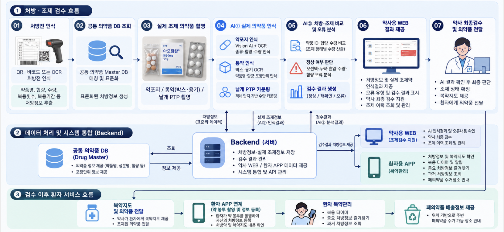
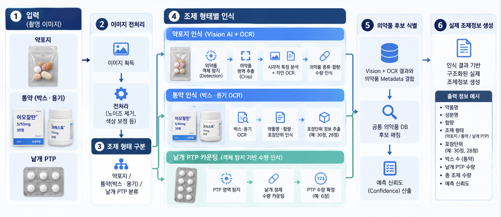
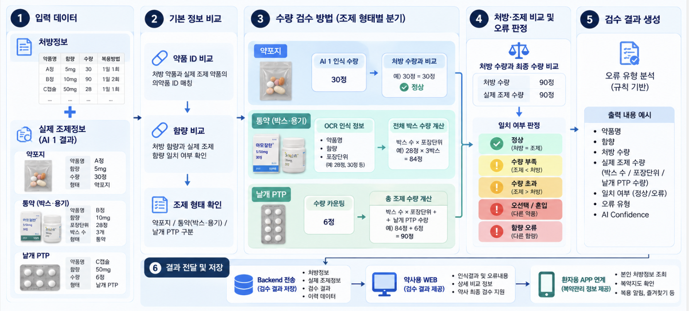
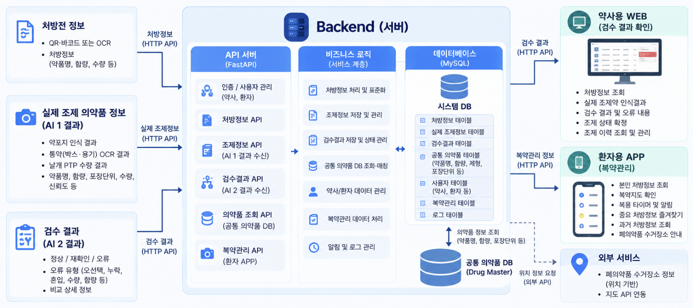
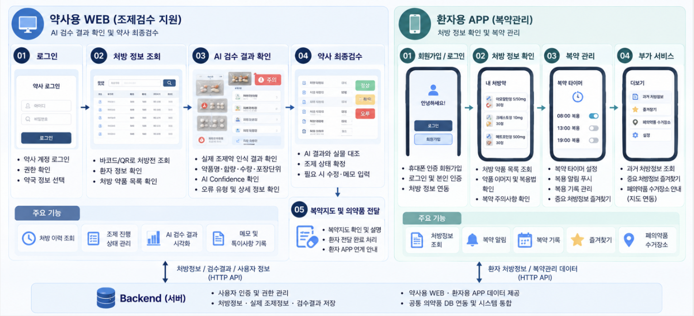
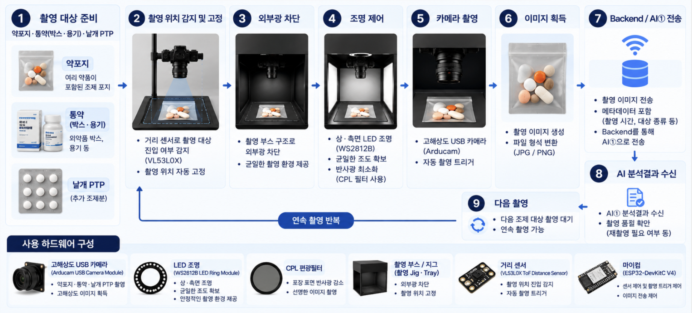

# AI 기반 처방·조제 검수 및 복약관리 통합 시스템 기획서

멀티모달 Vision AI 기반 의약품 인식 및 Human-AI 조제검수·복약지원 플랫폼

| 항목 | 내용 |
| --- | --- |
| 팀 | 졸업작품 8조 |
| 서비스명 | 미정 |
| 원본 작성일 | 2026-09-21 |
| Markdown 정리일 | 2026-10-13 |
| 문서 버전 | v1.0 Markdown 초안 |
| 기준 자료 | `26 졸작 8조.docx` |
| 문서 상태 | 기획 기준안 — 진행 상황에 따라 변경 가능 |

이 문서는 처방정보와 실제 조제 의약품을 인식·비교하여 약사의 최종검수를 지원하고, 검수 이후 환자의 복약관리까지 연결하는 졸업작품의 목표와 구현 계획을 정리한다. 원본 기획서를 기준으로 작성했으며, 실제 구현 완료 상태를 의미하지 않는다.

## 1. 문서 운영 및 변경 원칙

**본 기획서는 고정된 최종 명세가 아닌 변경 가능한 작업 문서다. 개발 진행 상황, 데이터 확보 수준, 실험 결과, 팀 협의 및 지도교수 피드백에 따라 기능 범위, 대상 의약품, 기술 스택, 하드웨어 구성, 성능 목표와 일정이 변경될 수 있다.**

- 원본의 계획은 유지하되, 실제 진행 상태와 확정 여부를 구분하여 기록한다.
- 검토 중인 기술과 부품은 도입이 확정된 것으로 해석하지 않는다.
- 변경 시 관련 본문과 진행 현황을 함께 갱신하고, 변경 이력에 날짜·내용·사유를 남긴다.
- 성능 수치는 검증 데이터와 실험 결과를 확보한 뒤 기록한다. 계획 수치와 측정 결과를 구분한다.
- 삽입된 흐름도는 원본 기획서의 개념도다. 본문 변경 시 그림도 갱신하며, 변경 내용과 그림이 불일치하면 최신 본문과 변경 이력을 기준으로 확인한다.
- 문서상의 정상·오류 판정은 검수 보조 결과이며, 최종 조제 적합 여부는 약사가 확인한다.

### 진행 상태 표기

| 상태 | 의미 |
| --- | --- |
| 확인 필요 | 실제 진행 여부 또는 근거를 아직 문서에 반영하지 않음 |
| 예정 | 수행하기로 계획했으나 착수하지 않음 |
| 진행 중 | 설계·개발·실험을 수행하고 있음 |
| 검증 중 | 구현 후 테스트와 결과 확인을 수행하고 있음 |
| 완료 | 합의된 완료 조건을 충족하고 근거를 기록함 |
| 보류 | 사유를 기록하고 일시적으로 진행을 중단함 |
| 제외 | 현재 구현 범위에서 제외함 |

## 2. 프로젝트 개요

### 2.1 문제와 목적

약사의 조제업무에서는 처방전에 기재된 의약품과 실제 준비된 의약품의 종류·함량·수량이 일치하는지 반복적으로 확인해야 한다. 본 프로젝트는 처방정보와 실제 조제정보를 각각 디지털 데이터로 변환하고 비교하여 이 검수 과정을 지원한다.

처방전은 QR·바코드 또는 OCR로 인식한다. 추출한 정보는 공통 의약품 Master DB에 매칭하여 표준화한다. 실제 조제 의약품은 촬영 Station에서 촬영하고, Vision AI·OCR·의약품 Metadata를 이용하여 식별한다. 두 정보를 독립적으로 생성·저장한 뒤 비교 모듈에서 오류를 분석한다.

약사는 WEB에서 인식 결과와 오류 내용을 확인하고 최종검수한다. 검수 이후 환자 APP으로 처방정보와 복약지도를 다시 확인하고 복용 알림 등의 기능을 이용할 수 있도록 한다.

### 2.2 전체 시스템 흐름



| 단계 | 처리 내용 |
| --- | --- |
| 01 처방전 인식 | QR·바코드 또는 OCR로 약품명, 함량, 수량, 복용횟수, 복용기간 등을 추출 |
| 02 공통 의약품 DB 조회 | 처방정보를 공통 DB와 매칭하여 표준화 |
| 03 실제 조제 의약품 촬영 | 약포지, 통약 박스·용기, 낱개 PTP를 촬영 Station에서 촬영 |
| 04 AI① 실제 의약품 인식 | 포장 형태별 Vision AI·OCR·수량 카운팅 수행 |
| 05 공통 의약품 DB 조회 | 인식 결과를 공통 DB와 매칭하여 실제 조제정보 생성 |
| 06 AI② 처방·조제 비교 | 약품 ID, 함량, 조제 형태 및 수량 비교 |
| 07 조제 오류 분석 | 정상·오선택·누락·혼입·수량 오류·함량 오류 및 재확인 필요 여부 생성 |
| 08 약사용 WEB 결과 제공 | 처방정보, 인식 결과, Confidence 및 오류 내용 표시 |
| 09 약사 최종검수 | 약사가 실제 조제 상태와 AI 결과를 확인하고 최종 판단 |
| 10 복약지도 및 의약품 전달 | 약사가 환자에게 복약지도와 의약품 제공 |
| 11 환자 APP 연계 | 검수 완료 처방정보 연계 또는 약 봉투 촬영을 통한 등록 |
| 12 환자 복약관리 | 복용 타이머·알림, 즐겨찾기, 과거 처방정보 조회 |
| 13 폐의약품 배출정보 제공 | 주변 수거 가능 장소 안내 |

QR·바코드가 외부 시스템의 조회용 식별정보만 포함하는 경우 연동 가능 여부를 확인한다. 연동이 불가능하거나 정보가 부족하면 OCR 또는 수동 확인 절차를 적용한다.

## 3. 목표와 대상 범위

### 3.1 최종 목표

내과 처방 의약품을 대상으로 처방정보와 실제 조제 의약품을 인식·비교하여 약사의 검수를 지원하고, 환자 복약관리까지 연결하는 통합 시스템을 구축한다. AI 1차 인식·분석 이후 약사가 최종 판단하는 Human-AI 협업 구조를 적용한다.

| 핵심 기능 | 내용 |
| --- | --- |
| 처방정보 디지털화 | QR·바코드 및 OCR로 처방정보 구조화 |
| 실제 의약품 인식 | 약포지 의약품 식별, 통약 OCR, 낱개 PTP 수량 인식 |
| 처방·조제 자동 비교 | 표준화한 두 정보를 비교하여 오류 분석 |
| 약사 검수 지원 | 인식 결과·Confidence·오류 표시 및 수정·최종검수 |
| 환자 복약관리 | 처방·복약지도 재확인, 복용 알림, 즐겨찾기 |
| 의약품 폐기 지원 | 주변 폐의약품 수거 가능 장소 안내 |

### 3.2 대상 의약품

초기 PoC의 병과는 내과로 제한한다. 대상 약물군은 고혈압, 당뇨, 고지혈증, 위염·위장관계 의약품의 네 범주로 계획한다. 구체적인 제품 목록과 품목 수는 데이터 확보 수준에 따라 확정한다.

| 포장 형태 | 검수 방식과 범위 |
| --- | --- |
| 약포지 | 1회 복용 단위 등으로 포장된 정제·캡슐의 종류·함량·수량 인식 |
| 통약 박스·용기 | 제품명·함량·포장단위를 OCR로 인식하고 포장 수량과 연결 |
| 낱개 PTP | 포장단위만으로 처방 수량을 충족하지 못할 때 추가되는 PTP의 실제 알약 수량 인식 |

초기 단계에서 산제·시럽은 제외한다. 정제·캡슐을 중심으로 기술적 가능성을 검증한다.

### 3.3 선정 이유와 한계

전체 의약품을 대상으로 하면 제조사·함량·제형별 이미지와 식별정보를 확보해야 한다. 본 프로젝트는 AI, Backend, Frontend, HW를 함께 개발하는 1년 규모의 통합 프로젝트이므로 초기 데이터 범위를 통제한다.

- 초기 모델은 선정된 품목에 한정되며 전체 의약품을 식별하는 범용 시스템이 아니다.
- 약포지의 반사·주름·겹침, 통약 인쇄 상태, PTP 배치에 따라 성능이 달라질 수 있다.
- 유사한 외형이나 부족한 각인정보 때문에 이미지로 제품을 확정하기 어려울 수 있다.
- 식별이 불확실하거나 필수 비교정보가 없으면 자동 정상 판정하지 않고 재확인을 요청한다.
- 대상 의약품과 데이터는 검증 결과에 따라 단계적으로 확장한다.

## 4. 벤치마킹과 차별화 방향

### 4.1 비교 대상

아래는 원본 기획서에서 선정한 비교 대상이다. 제출용 비교표의 구체적인 기능과 지원 범위는 제품별 공식 자료로 확인한 뒤 확정한다.

| 비교 대상 | 국가 | 비교 관점 | 확인할 사항 |
| --- | --- | --- | --- |
| Medility PillEye 및 관련 기술 | 대한민국 | Vision AI 기반 알약 수량 인식 | 수량 계수와 종류 식별·처방 비교 기능을 제품별로 구분 |
| YUYAMA TabSight-S | 일본 | 약포지의 수량·형상·색조 기반 검사 및 검수 지원 | 식별 방식, 적용 조건, 외부 시스템 연계 범위 |
| JVM 약포 검사시스템 | 대한민국 | 약포 촬영과 자동 검사 | 정확한 모델명, 식별·비교 기능 및 적용 범위 |

공식 자료 확인 경로:

- [Medility](https://www.medility.ai/en)
- [YUYAMA TabSight-S](https://www.yuyama.co.jp/en/product/tabsight-s/)
- [JVM VIZEN 제품 자료](https://www.myjvm.eu/wp-content/uploads/JVM-Vizen-EN.pdf)

### 4.2 차별화 방향

1. 처방정보 구조화부터 실제 조제정보 비교까지 연결한다.
2. Vision·각인 OCR·의약품 Metadata를 결합하여 식별한다.
3. 약포지·통약·PTP의 포장 특성에 맞는 검수 방식을 적용한다.
4. 약사용 WEB에서 불확실한 항목을 확인·수정하는 협업 구조를 제공한다.
5. 검수 완료 정보를 환자 복약관리로 연결한다.
6. 폐의약품 배출정보를 제공한다.

위 항목은 기획 단계의 차별화 방향이며, 기존 제품 대비 성능 우위가 입증되었다는 의미는 아니다. 실제 차별성은 구현 범위와 비교 실험 결과를 반영하여 갱신한다.

## 5. 파트별 설계와 기술 스택

### 5.1 AI① 실제 의약품 인식



촬영 이미지에서 약포지·통약·PTP를 구분하고 실제 조제정보를 생성한다.

1. YOLO로 정제·캡슐의 위치를 탐지하고 개별 영역을 추출한다.
2. OpenCV 전처리, 각인 OCR 및 이미지 특징 분석을 수행한다.
3. 외형 특징·OCR 결과·Metadata를 결합하여 공통 DB에서 의약품 후보를 매칭한다.
4. 통약은 제품명·함량·포장단위를 인식하고 PTP는 실제 포함된 알약 수량을 확인한다.
5. 종류·함량·수량·조제 형태·식별 Confidence를 Backend로 전달한다.

YOLO Class ID와 의약품별 식별 ID를 구분하고, 품목기준코드로 공통 DB에 연결한다. PTP 수량만으로 종류를 확정할 수 없으면 기존 인식 결과와 연결하거나 약사의 재확인을 요청한다.

| 구분 | 계획 기술 | 용도 |
| --- | --- | --- |
| 언어 | Python 3.11 권장 | 모델 개발 및 추론 |
| 딥러닝 | PyTorch | 탐지·특징 추출 |
| 객체 탐지 | Ultralytics YOLO | 알약 탐지 및 PTP 수량 인식 |
| OCR | PaddleOCR 우선 검토 | 각인 및 포장 문자 인식 |
| 이미지 처리 | OpenCV | 전처리·영역 추출 |
| 데이터 처리 | NumPy, Pandas | 데이터 관리 |
| 라벨링 | CVAT | 탐지 데이터 라벨링 |
| 특징 추출 | timm + PyTorch 2차 검토 | 이미지 특징 벡터 생성 |
| 후보 검색 | scikit-learn 2차 검토 | 유사도 기반 검색 |
| 데이터 연계 | 공통 의약품 Master DB | 의약품 매칭 |
| 평가 | Precision, Recall, F1-score, mAP | 인식·탐지 성능 확인 |

초기 PoC는 탐지·OCR·DB 매칭을 우선 구현한다. 객체 탐지 Confidence와 최종 식별 Confidence를 구분하고, 식별 신뢰도 산출 방식과 재확인 기준은 검증 데이터로 설정한다.

### 5.2 AI② 처방·조제 비교 및 오류 분석



원본의 파트명은 AI②이며, 초기 구현은 규칙 기반 비교 모듈로 계획한다.

1. Backend에서 표준화된 처방정보와 실제 조제정보를 수신한다.
2. 같은 공통 DB 식별정보를 기준으로 약품 ID·함량·조제 형태·수량을 비교한다.
3. 정상·오선택·누락·혼입·수량 오류·함량 오류를 구분한다.
4. 낮은 식별 신뢰도나 필수 정보 누락은 재확인 대상으로 분류한다.
5. 오류 대상·비교 상세·재확인 여부를 Backend로 전달한다.

통약 수량의 기본 계산 계획은 다음과 같다. 실제 적용 조건과 단위는 상세 설계에서 확정한다.

```text
실제 조제 수량 = 전체 포장 개수 × 포장단위 + 낱개 PTP의 실제 알약 수량
```

| 구분 | 계획 기술·항목 |
| --- | --- |
| 언어 | Python |
| 판정 방식 | 규칙 기반 비교 로직 |
| 데이터 처리 | Pandas, NumPy |
| 연동 | FastAPI, 공통 의약품 DB |
| 입력 | 처방정보, 실제 조제정보, 식별 신뢰도 |
| 출력 | 일치 여부, 오류 유형, 오류 대상, 재확인 여부 |

ML 도입은 확보 데이터와 오류 분석 결과를 바탕으로 필요성을 검토한다. AI① 인식 성능과 AI② 비교·판정 성능은 별도로 평가한다.

### 5.3 Backend 데이터 및 시스템 통합



- QR·바코드·OCR 결과를 수신하여 처방정보를 표준화한다.
- 처방정보와 실제 조제정보가 같은 Drug Master DB를 참조하도록 관리한다.
- 이미지·AI① 결과·AI② 결과·검수 상태를 연결하고 저장한다.
- 약사가 수정한 정보와 최종 판단을 별도로 보존한다.
- WEB·APP에 REST API를 제공한다.
- 약사·환자·관리자 접근 권한을 구분하고 환자는 본인 처방정보만 조회한다.
- 처방정보와 검수 결과의 변경 이력을 관리한다.

| 구분 | 계획 기술 | 용도 |
| --- | --- | --- |
| 언어 | Python | 서버 로직 |
| 프레임워크 | FastAPI | API 및 파트 연동 |
| DB | MySQL | 처방·조제·검수·사용자·복약정보 저장 |
| ORM | SQLAlchemy | DB 연동 |
| 통신 | REST API | 데이터 송수신 |
| 인증 | JWT | 로그인 및 권한 확인과 연계 |
| API 문서 | Swagger / OpenAPI | 명세 공유 및 테스트 |
| 실행 환경 | Docker | 환경 통일 |
| 협업 | Git / GitHub | 버전관리 |

공통 의약품 DB의 계획 항목: 내부 Drug ID, 품목기준코드·제품코드, 제품명, 성분명, 함량, 제형, 제조사, 식별문자, 색상, 모양, 포장단위. 상세 스키마와 데이터 출처는 추후 확정한다.

### 5.4 Frontend 약사용 WEB 및 환자용 APP



약사용 WEB은 처방 목록과 상세정보, 실제 조제정보, AI 인식 결과·Confidence·오류 내용을 표시한다. 약사는 잘못 인식한 정보와 수량을 수정하고 최종검수 결과를 저장한다. 검수 담당자·시각·수정 이력을 조회하고 관리자 설정은 별도 권한으로 구분한다.

환자용 APP은 검수 완료 처방정보 조회, 복약지도 재확인, 복용 타이머·알림, 즐겨찾기, 과거 처방내역 및 복용 기록을 지원하는 방향으로 설계한다.

- 시스템 연계 등록: 검수 완료 처방정보가 존재하면 연계용 QR·바코드 또는 등록 식별정보를 통해 환자와 연결한다.
- OCR 등록: 약 봉투에서 추출한 정보는 사용자 확인·수정 후 등록한다. OCR 등록정보를 약사 검수 완료 정보로 간주하지 않는다.
- 폐의약품 수거처: 위치 동의를 받아 지도와 수거처 데이터를 연결한다. 동의하지 않으면 지역명·주소로 검색한다.
- 복약정보: 약사가 확인한 정보를 다시 제공하는 것을 기본 방향으로 하며 AI가 새로운 복약지시를 임의 생성하지 않는다.

| 구분 | 계획 기술 |
| --- | --- |
| WEB | React, JavaScript / TypeScript |
| APP | Flutter, Dart |
| 서버 연동 | REST API |
| 인증 | JWT와 사용자별 접근 권한 확인 |
| 화면 설계 | Figma |
| 지도·위치 | 지도 API 추후 선정, 수거처 데이터 출처 확인 필요 |

### 5.5 HW 촬영 Station



고정형 구조물·트레이로 촬영 거리와 위치를 유지하고, 외부광 차단·LED·편광필터를 검토하여 반사를 줄인다. 이미지는 대상 유형과 촬영정보에 연결하여 Backend 또는 AI①로 전달한다. 흐림이나 영역 이탈 시 재촬영한다.

| 구분 | 계획 장치·부품 | 용도 |
| --- | --- | --- |
| 카메라 | Arducam USB Camera Module 계열 | 고해상도 이미지 획득 |
| 조명 | WS2812B LED Ring Module | 촬영 조명 제어 |
| 편광필터 | CPL Circular Polarizing Filter | 포장 반사 억제 검토 |
| 구조물 | 맞춤 제작 Jig / Tray | 촬영 위치·거리 유지 |
| 코드 인식 | DYScan DE2120 2D Barcode Scanner Module | QR·바코드 입력 |
| MCU | ESP32-DevKitC V4 | 센서·조명 제어 |
| 감지 센서 | VL53L0X ToF Distance Sensor Module | 촬영 위치 진입 감지 |
| 연산·통신 | PC / 노트북 | 이미지 수신·추론·서버 연동 |
| 자동화 확장 | NEMA 17 + A4988 Driver | 약포지 자동 이송 검토 |

개발 순서는 고정형 Station → 센서 기반 촬영 자동화 → 필요 시 자동이송으로 계획한다. 촬영·전송 제어 주체와 부품 상세 사양은 실험 및 상세 설계에 따라 확정한다.

## 6. 데이터 및 검증 계획 확정 항목

원본 기획서에는 아래 항목의 구체적인 수치와 조건이 정해져 있지 않다. 개발 진행에 따라 확정하고 결과를 갱신한다.

| 항목 | 현재 정의 | 다음 기록 내용 |
| --- | --- | --- |
| 대상 품목 | 내과 네 약물군의 정제·캡슐 | 제품 목록, 품목기준코드, 품목 수 |
| 데이터 확보 | 공개 이미지·Metadata 및 자체 촬영 계획 | 출처, 이용 조건, 실물 확보 경로, 데이터 수 |
| 라벨링 | CVAT 활용 계획 | 라벨 기준, 담당자, 검수 방법 |
| 촬영 조건 | 고정형 Station 계획 | 해상도, 거리, 조명, 각인·겹침·반사 조건 |
| 비교 단위 | 종류·함량·수량 비교 | 1회 약포지와 처방 전체 수량의 연결 기준 |
| 통약·PTP 조건 | 포장단위와 실제 알약 수량 사용 | 미개봉·개봉 구분, 빈 PTP 처리, 품목 연결 |
| 식별 실패 처리 | 약사 재확인 | 미등록 약, 가림, 각인 누락, 재촬영 기준 |
| 데이터 분할 | 미정 | 학습·검증·테스트 분리 기준 |
| 성능 목표 | 지표 종류만 제시 | 지표별 목표값, 표본 수, 측정 조건 |
| 시스템 검증 | 제한된 데이터의 End-to-End 검증 계획 | 오류 시나리오, 정상 오판, 재확인 비율, 처리시간 |
| 사용자 검증 | 약사 최종검수 구조 | 검수 흐름 피드백과 사용성 확인 방법 |

## 7. 주차별 개발 계획

다음 일정은 원본의 1학기 5~15주차 계획이다. 실제 달력 날짜나 완료 여부는 아직 확인되지 않았으며, 진행 상황에 따라 수정한다.

| 주차 | 개발 목표 | 핵심 작업 |
| --- | --- | --- |
| 5 | 상세 시스템 설계 | 전체·파트별 흐름, 역할·입출력, 공통 DB 설계 |
| 6 | 대상 의약품·데이터 기준 확정 | 품목·포장 범위, 포장단위, 수집·라벨링 기준 |
| 7 | 데이터·환경 확보 | 공개 데이터, 자체 촬영 시작, 개발·Git 환경 |
| 8 | 파트별 상세 설계 | 모델, DB·API, UI·UX, 촬영 Station·부품 |
| 9 | 1차 프로토타입 시작 | 탐지·OCR 기초모델, DB·API, 기본 화면, 촬영장치 |
| 10 | AI① 인식 PoC | 약포지 식별, 통약 OCR, PTP 카운팅, Confidence 실험 |
| 11 | 처방·공통 DB PoC | QR·바코드·OCR, DB 조회, 표준화·저장 |
| 12 | AI② 비교 PoC | 오선택·누락·혼입·수량·함량 오류 규칙 구현 |
| 13 | 1차 연동 | HW → AI① → Backend → AI② → WEB |
| 14 | 통합 테스트·개선 | End-to-End 검증, 연동 수정, 기초 성능평가 |
| 15 | 중간 결과 발표 | 시연, 초기 지표, 한계 분석, 2학기 계획 |

2학기 상세 일정은 중간 결과와 확보 데이터를 바탕으로 수립한다.

## 8. 진행 현황

아래 상태는 원본의 계획과 실제 완료 상태를 혼동하지 않도록 초기값을 설정한 것이다. 실제 착수·완료 여부를 팀에서 확인한 뒤 수정한다.

| 작업 | 진행 상태 | 담당 | 완료 조건·근거 | 최근 갱신 |
| --- | --- | --- | --- | --- |
| Markdown 기획 문서 정리 | 완료 | 문서 정리 | 원본의 목표·설계·일정과 변경 원칙 반영 | 2026-10-13 |
| 대상 품목·데이터 기준 확정 | 확인 필요 | 미정 | 품목 목록·확보 경로·라벨 기준 기록 필요 | — |
| 공통 Drug Master DB 구축 | 확인 필요 | 미정 | 스키마·데이터 출처·매칭 검증 기록 필요 | — |
| 촬영 Station 제작 | 확인 필요 | 미정 | 촬영 조건·반사 및 흐림 실험 기록 필요 | — |
| AI① 인식 PoC | 확인 필요 | 미정 | 품목별 식별·수량·실패 결과 기록 필요 | — |
| 처방정보 인식·구조화 | 확인 필요 | 미정 | QR·OCR·수동 확인 흐름 검증 필요 | — |
| AI② 비교·판정 | 확인 필요 | 미정 | 오류 유형별 비교 규칙·검증 기록 필요 | — |
| Backend·권한·이력 | 확인 필요 | 미정 | API·본인 처방 접근·수정 이력 검증 필요 | — |
| 약사용 WEB | 확인 필요 | 미정 | 인식 결과 확인·수정·최종검수 시연 필요 | — |
| 환자 APP | 확인 필요 | 미정 | 등록정보 구분·처방 연계·알림 검증 필요 | — |
| 폐의약품 위치정보 | 확인 필요 | 미정 | 수거처 데이터·위치 검색 검증 필요 | — |
| 통합 테스트 | 확인 필요 | 미정 | 핵심 경로 시연·평가 결과 기록 필요 | — |

## 9. 흐름도 표현 기준

| 용도 | 색상 | HEX |
| --- | --- | --- |
| 제목·핵심 | Main Navy | `#16324F` |
| AI·시스템 | Medical Blue | `#2F80ED` |
| 정상·환자 서비스 | Mint | `#35B7A5` |
| 박스 배경 | Light Blue | `#EAF3FF` |
| 재확인 | Warning | `#F2C94C` |
| 오류 | Error | `#EB5757` |
| 전체 배경 | Background | `#F7F9FC` |
| 본문 | Text | `#263238` |

전체 및 파트별 흐름도는 동일한 색상 기준을 사용한다. 예시 약명·함량·수량과 본문 정의의 일치 여부를 제출 전에 확인한다.

## 10. 변경 이력

| 날짜 | 버전 | 변경 내용 | 사유 |
| --- | --- | --- | --- |
| 2026-09-21 | 원본 v1.0 | DOCX 기획 기준안 작성 | 프로젝트 초기 기획 |
| 2026-10-13 | v1.0 Markdown 초안 | Markdown 정리, 원본 흐름도 첨부, 변경 원칙·진행 현황·미확정 항목 추가. 벤치마킹은 공식 자료 확인 대상으로 구분 | 진행 상황에 따라 갱신 가능한 문서 마련 |

향후 변경 시 이 표에 새 행을 추가하고 관련 본문 및 진행 현황을 함께 수정한다.
